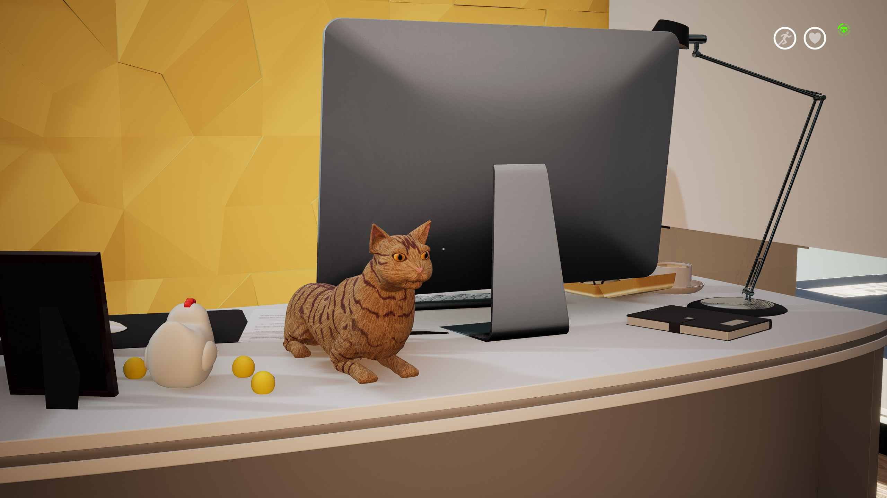
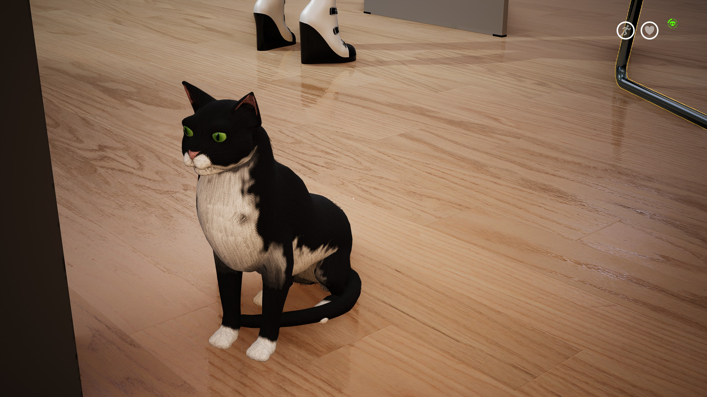
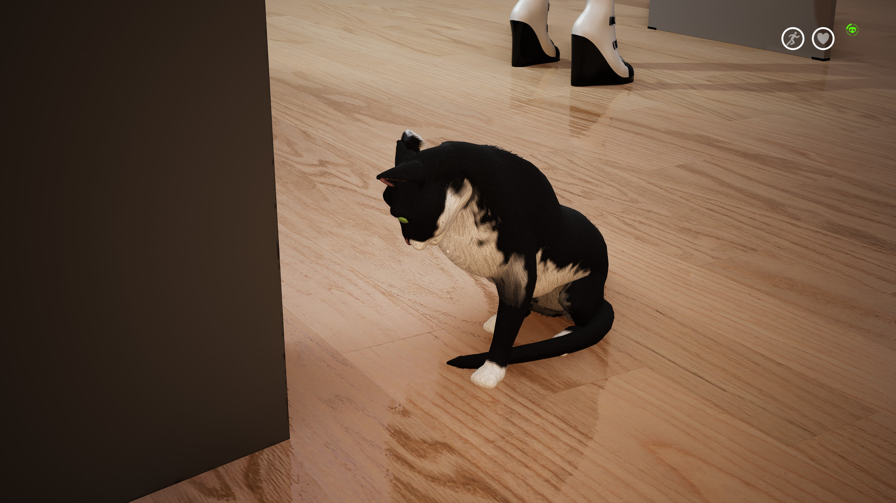
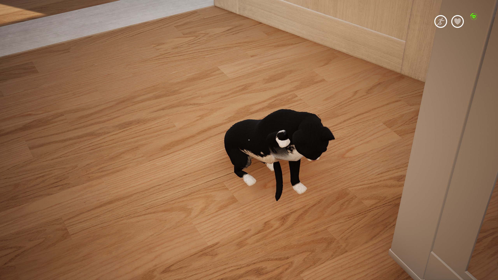
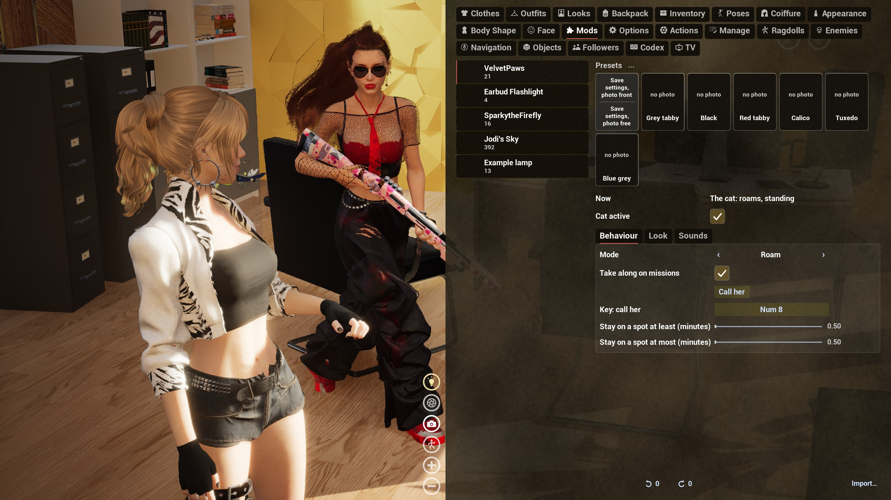
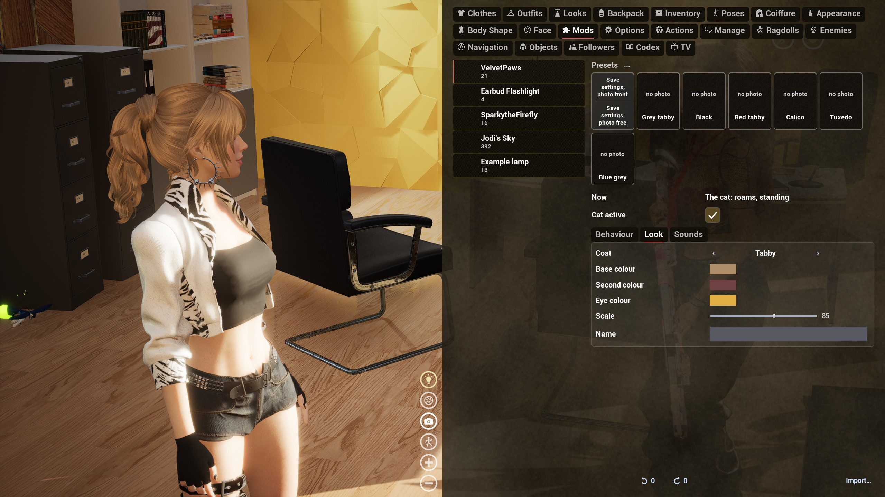
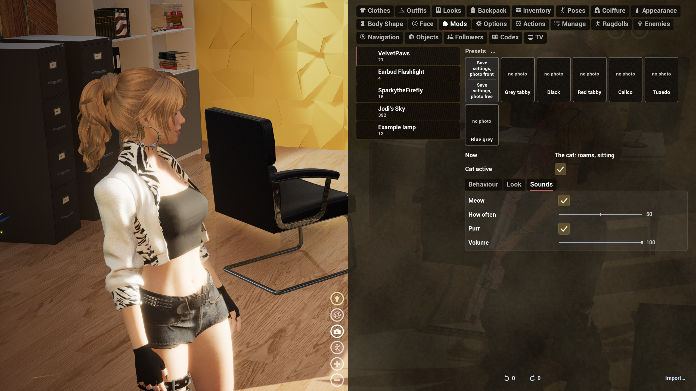

# VelvetPaws

A cat companion mod for *The Killing Antidote*. She follows Jodi, waits or roams, climbs onto furniture, window sills
and shelf compartments, sits, lies and sleeps there, purrs and meows, and now and then weaves around Jodi's legs.
Jodi's office is her home. Settings live on her own page in [AltUI](https://github.com/Zyiakk/AltUI)'s Mods tab.

Everything about the cat is made from scratch by script: model, skeleton, fur textures and all animations are generated
in Blender; meows and purring are cut from real recordings, hissing, yawning and landing are synthesised.

| | | |
|---|---|---|
|  |  |  |

## Install

Download the zip of a release (`versions/<version>/`) and copy:

| File | Copy to |
|---|---|
| `TKA_BlueprintLoader.pak` ([Blueprint Loader](https://www.nexusmods.com/thekillingantidote/mods/994?tab=files), separate mod) | `TheKillingAntidote/Content/Paks/~mods/` |
| `VelvetPaws.pak` | `TheKillingAntidote/Mods/` |

AltUI is recommended; without it the cat runs with her defaults. Details: `versions/<version>/README.md`.

## Settings

Her page in AltUI's Mods tab has three tabs - behaviour, look and sounds - and presets for common coats.

| | |
|---|---|
|  |  |

## Build

Linux, Blender 5.x, Unreal Engine 4.27 with the game's sample mod project, an AltUI checkout (BPGen, editor scripts, pak
tools) and Wine for the Windows cook. Copy `config.example.sh` to `config.sh`, adjust the paths, close the game and run
`scripts/build.sh` (`--no-deploy` skips copying the pak into the game). Unit tests: `python3 -m unittest discover -s tests -t .`.

| Path | What it is |
|---|---|
| `tools/blender/` | rig, model, fur bake, poses and animations (`cat_seqs.py` lists every sequence) |
| `assets/gen/` | Blueprint generators for BPGen (`BP_VP_Cat`, anim blueprint, montages, tables) |
| `scripts/velvetpaws/` | behaviour reference (`brain.py`), AltUI page (`ui.py`), office map, sounds |
| `assets/office/` | the office map: spots, jump points and paths, measured from the level |
| `assets/sounds/` | the prepared recordings |

## License

MIT, see `LICENSE`.
